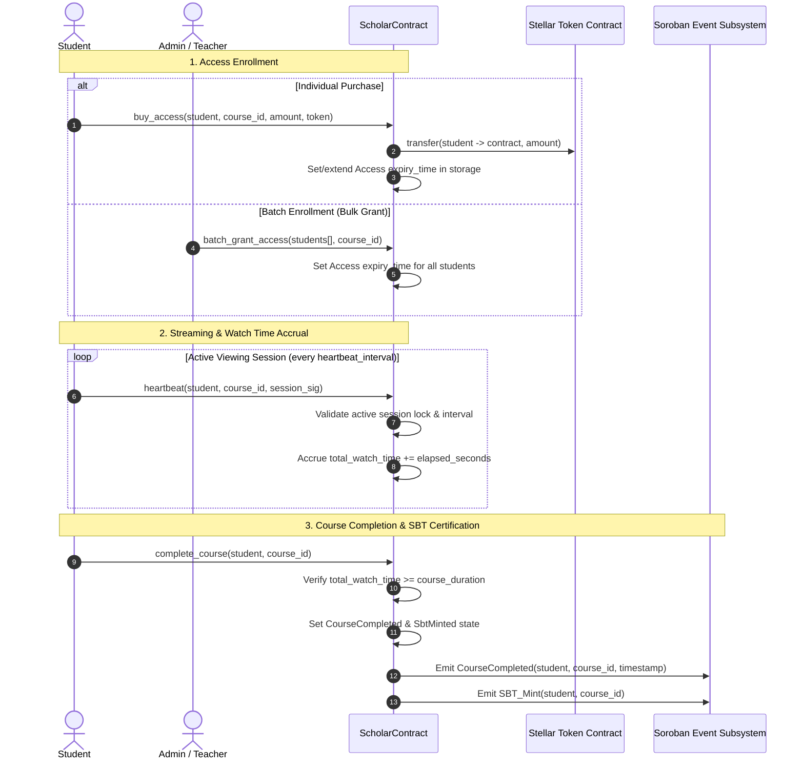

# Soroban Project

## Project Structure

This repository uses the recommended structure for a Soroban project:

```text
.
├── contracts
│   └── hello_world
│       ├── src
│       │   ├── lib.rs
│       │   └── test.rs
│       └── Cargo.toml
├── Cargo.toml
└── README.md
```

- New Soroban contracts can be put in `contracts`, each in their own directory. There is already a `hello_world` contract in there to get you started.
- If you initialized this project with any other example contracts via `--with-example`, those contracts will be in the `contracts` directory as well.
- Contracts should have their own `Cargo.toml` files that rely on the top-level `Cargo.toml` workspace for their dependencies.
- Frontend libraries can be added to the top-level directory as well. If you initialized this project with a frontend template via `--frontend-template` you will have those files already included.

## Deployed Contract
- **Network:** Stellar Testnet
- **Contract ID:** CB7OZPTIUENDWJWNHRGDPZLIEIS6TXMFRYT4WCGHIZVYLCTXEONC6VHY


## Session Security

This contract prevents multi-device streaming by enforcing a strict single-session lock per user account. 

It natively extends the existing `heartbeat` function to validate a unique 32-byte `session_hash` (passed via the previously unused `_signature` parameter), ensuring complete backward compatibility with zero breaking changes to the API.

**How it works:**
* **Accepted Session:** When a heartbeat is received, it checks the stored session hash. If the hash matches the active session, or if the previous session has safely timed out (exceeding the `heartbeat_interval`), the stream is securely permitted.
* **Rejected Session:** If the incoming hash does not match the stored hash *and* the previous session is currently active, the contract explicitly rejects the heartbeat. This immediately halts unauthorized parallel streams or duplicate logins.

## Student Lifecycle & Streaming Architecture

### Core Flow: Deposit -> Watch Time -> Completion & SBT Minting



### Relationship Between `buy_access`, `batch_grant_access`, and `has_access`

* **`buy_access(student, course_id, amount, token)`**: The transactional entry point where an individual student deposits tokens to purchase streaming time. It calculates seconds bought using dynamic rate discounts (`calculate_dynamic_rate`) and extends the student's `Access.expiry_time`.
* **`batch_grant_access(caller, students, course_id)`**: An administrative and institutional optimization allowing an authorized Admin, Teacher, or Course Creator to enroll multiple students in a single transaction, setting storage expiry timestamps efficiently.
* **`has_access(student, course_id)`**: The immutable read-only gatekeeper used by media players and frontends to verify streaming eligibility before delivering video chunks. It returns `true` if:
  1. The course is not vetoed globally (`VetoedCourseGlobal`), AND
  2. The course is not vetoed for the student (`VetoedCourse`), AND
  3. The student has an active subscription covering `course_id`, OR
  4. The current ledger timestamp is strictly less than `Access.expiry_time` (`env.ledger().timestamp() < access.expiry_time`).

